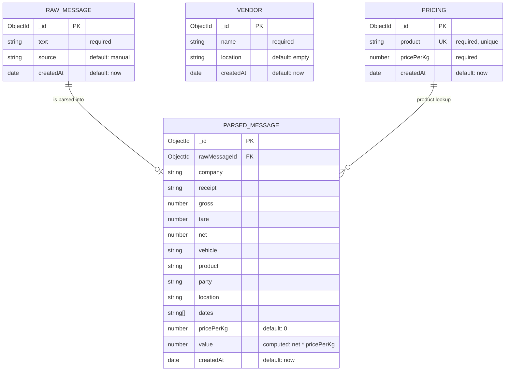

# Entity-Relationship Diagram — SMS Ingestion Dashboard

This diagram represents the persistent MongoDB/Mongoose entities implemented by
the project. Authentication sessions and analytics are excluded because they
are runtime/application concerns, not application collections.



## UML Class Diagram

The UML view shows the application models and the service operations that
create, parse, price, and reprocess messages.

```mermaid
classDiagram
    class RawMessage {
        +id: ObjectId {PK}
        +text: String {required}
        +source: String
        +createdAt: Date
        %% source defaults to "manual"
    }

    class ParsedMessage {
        +id: ObjectId {PK}
        +rawMessageId: ObjectId {FK}
        +company: String
        +receipt: String
        +gross: Number
        +tare: Number
        +net: Number
        +vehicle: String
        +product: String
        +party: String
        +location: String
        +dates: String[]
        +pricePerKg: Number
        +value: Number
        +createdAt: Date
        %% pricePerKg defaults to 0
    }

    class Vendor {
        +id: ObjectId {PK}
        +name: String {required}
        +location: String
        +createdAt: Date
        %% location defaults to ""
    }

    class Pricing {
        +id: ObjectId {PK}
        +product: String {unique}
        +pricePerKg: Number {required}
        +createdAt: Date
    }

    class SMSIngestionService {
        +parseMessage(text: String) ParsedMessage
        +storeMessage(text: String, source: String) RawMessage
        +reparseMessages() void
        +calculateValue(net: Number, price: Number) Number
    }

    RawMessage "1" --> "0..1" ParsedMessage : rawMessageId
    ParsedMessage "0..*" --> "1" Vendor : company
    ParsedMessage --> Pricing : product lookup
    SMSIngestionService ..> RawMessage : uses
    SMSIngestionService ..> ParsedMessage : uses
```

### UML Interpretation

- `RawMessage`, `ParsedMessage`, `Pricing`, and `Vendor` are persistent model
  classes backed by MongoDB collections.
- `SMSIngestionService` is a logical service class representing the parsing,
  storage, pricing, and reparse operations implemented by the backend scripts.
- `ParsedMessage.company` is associated with `Vendor` through the `company`
    relationship label.
- `ParsedMessage.product` is associated with `Pricing` through the `product
    lookup` relationship.

## Entity Notes

| Entity | Purpose |
| --- | --- |
| `RAW_MESSAGE` | Canonical SMS text received by manual entry or upload. |
| `PARSED_MESSAGE` | Structured receipt data extracted from one raw SMS. |
| `PRICING` | Unique price-per-kilogram configuration for each product. |
| `VENDOR` | Vendor master data maintained by the dashboard. It is currently independent of receipt records. |

## Relationship Notes

- `PARSED_MESSAGE.rawMessageId` is a real MongoDB ObjectId reference to `RAW_MESSAGE._id`.
- Logically, one raw message produces zero or one parsed message. Parsing can
    fail, so a raw message may exist without a parsed record.
- `PARSED_MESSAGE.product` is matched to the unique `PRICING.product` value
    when a message is stored or reparsed. This is a business-key lookup, not a
    stored foreign key; `ParsedMessage` may therefore have no matching pricing
    record.
- `PARSED_MESSAGE.pricePerKg` stores the looked-up price, and `value` stores
    the derived calculation `(net ?? 0) * pricePerKg` at processing time.
- `VENDOR` has no foreign-key relationship in the current implementation.

## Legend

- `PK` — MongoDB document primary key (`_id`).
- `FK` — stored foreign-key reference.
- `UK` — unique business key.
- `||--o|` — one parent to zero or one child.
- `||--o{` — one pricing record to zero or many parsed records.
