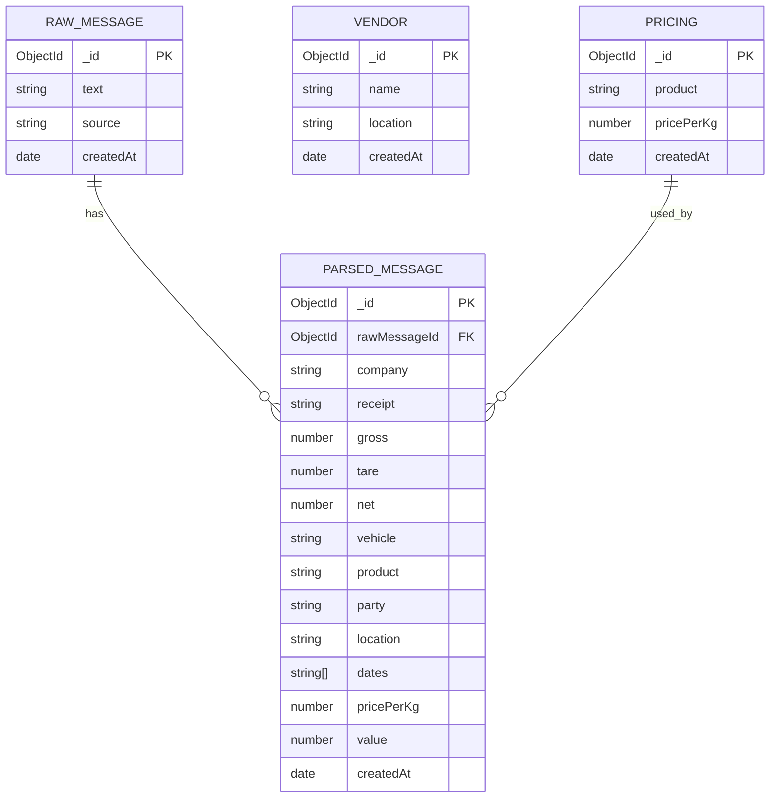

# SMS Dashboard — Full Documentation

This single comprehensive document consolidates the repository documentation: schema definitions, parsing logic, server APIs (with examples), client UI components (detailed), diagrams, and operational notes.

Contents
- Models & schema definitions
- Parsing & ingestion flow
- Server API reference (endpoints + examples)
- OpenAPI spec location
- Client: UI components and data flows (detailed)
- Diagrams (Mermaid + SVG reference)
- Dev / operational steps
- Files of interest

---

**Models & Schema Definitions (Mongoose)**

1) `RawMessage` (collection: rawmessages)
- _id: ObjectId — primary key
- text: String (required) — raw SMS content (trimmed before saving)
- source: String (default: 'manual') — ingestion source label (manual/upload)
- createdAt: Date (default: now)

Notes: duplicate detection uses exact `text` equality (trimmed). `RawMessage` documents are the canonical raw inputs.

2) `ParsedMessage` (collection: parsedmessages)
- _id: ObjectId
- rawMessageId: ObjectId (ref: `RawMessage`) — relation to the raw message
- company: String
- receipt: String
- gross: Number
- tare: Number
- net: Number
- vehicle: String
- product: String
- party: String
- location: String
- dates: [String] — array of date/time strings extracted from text
- pricePerKg: Number (default: 0) — looked up from `Pricing` by `product`
- value: Number (default: 0) — computed as `(net ?? 0) * pricePerKg`
- createdAt: Date (default: now)

Indexes/Constraints:
- `Pricing.product` is unique.

3) `Vendor`
- _id: ObjectId
- name: String (required)
- location: String (default: '')
- createdAt: Date

4) `Pricing`
- _id: ObjectId
- product: String (required, unique)
- pricePerKg: Number (required)
- createdAt: Date

Relationships summary:
- `ParsedMessage.rawMessageId` -> `RawMessage._id` (one RawMessage may have zero or one ParsedMessage; parsed created from raw)
- `ParsedMessage.product` is used as a lookup key against `Pricing.product` to determine `pricePerKg`.

---

**Parsing & Ingestion Flow**

Core functions (server/server.js and server/reparse.js):

- `parseMessage(text)` — normalises input, splits into lines, strips empty lines, handles single-line CSV-like payloads, and extracts fields using heuristics and regexes. Key parsing rules:
  - Accepts prefixes like `G:`, `T:`, `N:` and words `GROSS WEIGHT`, `TARE WEIGHT`, `NET WEIGHT` to extract numeric weights.
  - Accepts `R:` / `RST:` for receipt identifiers.
  - Extracts `DATE`, `TIME` fields and appends times to the most recent parsed date.
  - Parses vehicle markers: `VE-`, `VE `, `VEHICLE NO:`.
  - Parses product labels: `PR-`, `PR `, `PROD NAME:`.
  - Parses party: `PA-`, `PARTY NAME:`.
  - First unrecognised non-empty line is used for `company`.

The function returns an object with extracted fields or `null` if parsing fails.

- `storeMessage(text, source)`
  - Calls `parseMessage` — if parse fails, throws an error.
  - Normalises raw text and checks `RawMessage` for an existing document with identical `text`. If present, returns duplicate info.
  - Creates `RawMessage` then looks up `Pricing` by `parsed.product` to obtain `pricePerKg` (0 if not found).
  - Computes `value = (parsed.net ?? 0) * pricePerKg` and creates `ParsedMessage` with parsed fields + pricing + value.

- `reparse.js` — a utility script that connects to the DB, iterates all `RawMessage` documents, re-parses (using current parsing logic), and creates/updates `ParsedMessage` documents accordingly. Useful after parser improvements.

Error/edge cases handled:
- Uploaded messages shorter than 5 characters are skipped.
- File uploads may contain JSON arrays of strings or objects { text } — or plain-text separated by blank lines.
- Exact text duplicates are detected and returned in `duplicates` list during upload.

---

**Server API Reference (key endpoints with examples)**

General notes:
- Server expects cookies/session for protected endpoints. Client sends `credentials: 'include'`.
- Content type for JSON endpoints: `application/json`.

Auth
- POST /auth/login
  - Body: { username, password }
  - Success: 200 { ok: true } + session cookie
  - Failure: 401 { error: 'Invalid credentials' }

- POST /auth/logout
  - Destroys session. Returns 200 { ok: true }.

- GET /auth/me
  - Returns 200 { user: <username|null> }

Messages / Parsing
- POST /messages
  - Body: { text, source? }
  - 201: { raw, parsed }
  - 400: { error: 'text is required' | 'Could not parse message' }
  - Example request:

    POST /messages
    {
      "text": "COMPANY\nR:12345\nG: 42180\nN: 42180 - Example message"
    }

  - Example response (201):

    {
      "raw": { "_id": "...","text": "...", "source": "manual", "createdAt": "..." },
      "parsed": { "_id": "...","rawMessageId": "...","company":"COMPANY","receipt":"12345","gross":42180,"net":42180,"createdAt":"..." }
    }

- GET /messages
  - Returns list of `RawMessage` documents sorted desc by `createdAt`.

- GET /parsed or GET /processed
  - Returns list of `ParsedMessage` documents sorted desc by `createdAt`.

- POST /messages/parse
  - Dry run parser (no DB write). Body: { text }
  - 200: parsed object (same shape as ParsedMessage fields)

Vendors
- POST /vendors — Body: { name, location? }
  - 201: created vendor document
  - 400: { error: 'name is required' }

- GET /vendors — returns vendor list sorted by name.

Pricing
- POST /pricing — Body: { product, pricePerKg }
  - Upserts pricing entry (create or update)
  - 201: pricing document

- GET /pricing — list pricing entries sorted by product.

Upload / Bulk
- POST /upload
  - Authenticated endpoint (session cookie required)
  - Accepts multipart/form-data with field `file` (JSON array or plain text)
  - Returns 201: { processed, duplicates, skipped, results }

Analytics & Health
- GET /analytics — returns { messageCount, totalWeight, totalValue }
- GET /health — returns { status: 'ok', db: 'connected'|'disconnected' }

OpenAPI spec
- The repository contains an OpenAPI 3.0 spec at [openapi.yaml](openapi.yaml). Use Swagger UI or `redoc` to render it.
  - Example: `npx redoc-cli serve openapi.yaml` or install `swagger-ui` to host locally.

---

**Client: UI components and detailed behavior**

All client UI lives in `client/src/App.js` as a single-file React app. The app is intentionally self-contained; below is a component-level breakdown with props, state, side-effects, and network interactions.

Root
- `App` (root)
  - Responsibilities: check session (`GET /auth/me`) on mount, show loader while checking, route to `Dashboard` when authenticated or `Login` when not.
  - State: `user` (string|null), `checking` (boolean)
  - Network calls: `GET ${API}/auth/me` (credentials included)

Authentication
- `Login` component
  - Props: `onLogin(username)` — called on successful sign-in.
  - State: `username`, `password`, `error`.
  - Behavior: sends `POST /auth/login` with `{username,password}`. On success, calls `onLogin(username)` (client simply sets username in memory). Fails show user-facing error.

Dashboard & Tabs
- `Dashboard` (main authenticated hub)
  - Props: `user`, `onLogout()`
  - State: `tab` (messages/vendors/pricing/upload/analytics), `refreshKey` numeric used to force child reloads
  - Behavior: renders top bar, tab buttons, and shows selected tab component. `logout()` triggers `POST /auth/logout` then calls `onLogout()`.

Shared styling
- `GlobalStyle()` — injects app-wide CSS (table styling, responsive rules, focus outlines).
- `S` object — design tokens and inline style objects used throughout (header, buttons, table, cards). Keep layout and tokens centralized here.

Analytics
- `useAnalytics()` (hook)
  - Fetches `/analytics` once on mount
  - Returns `{ data, loading, error }` where data is the analytics object

- `StatsBar` + `StatCard`
  - Visual metric cards used on `Dashboard` and `Messages` view

Messages / Register
- `Messages` component
  - State: `messages` (array), `loading`, `error`, `query` (filter string)
  - Fetches `/processed` (alias for `/parsed`) on mount and when `refreshKey` changes
  - Filtering: lowercases `query` and matches against `m.party`, `m.vehicle`, or `m.receipt`. Partial substring matching.
  - Table columns: Receipt | Date (first date item) | Vehicle | Party | Net kg (number formatted en-IN) | ₹/kg | Value
  - Formatting: Missing numeric fields are shown as `—` with muted style. Currency rendered with `₹` and local formatting.

Vendors
- `Vendors` component
  - State: `vendors`, `name`, `location`, `error`
  - Fetch: `GET /vendors` on mount and after creating
  - Create: `POST /vendors` sends `{ name, location }` (JSON) and refreshes list on success

Pricing
- `Pricing` component
  - State: `pricing`, `product`, `price`, `error`
  - Fetch: `GET /pricing` on mount
  - Upsert: `POST /pricing` sends `{ product, pricePerKg }` (JSON). Server performs upsert (findOneAndUpdate with upsert)

Upload
- `Upload` component
  - Props: `onUploadSuccess()` (optional) — called after successful upload to trigger refresh
  - State: `file` (File), `status` (message object), `loading`
  - UI: file picker (accepts `.json`), button to upload
  - Network: multipart POST `/upload` with form field `file` (credentials included). Server returns counts: processed, duplicates, skipped.
  - Edge handling: shows friendly messages if file not selected, upload failed, or server unreachable

Shared primitives
- `DataRow` — used to render key/value rows in analytics summary

Client conventions and notes
- Default API root in client: `REACT_APP_API_URL` fallback `http://localhost:3003`.
- All cross-origin requests use `credentials: 'include'` to preserve the `express-session` cookie.
- UI is intentionally small and single-file for simplicity; splitting into smaller components is straightforward.

---

**Diagrams**

Mermaid ER diagram (also saved at `ER_DIAGRAM.md`):



Rendered SVG is available at `assets/er_diagram.svg` and raster PNG can be generated by running the script:

```bash
npm install puppeteer --save-dev
npm run generate:diagram
```

---

**Operational / Dev Notes**

- Start server and client (project already provides convenience scripts):

```powershell
npm run install-all
npm run dev
```

- Environment variables of interest:
  - `MONGO_URI` (defaults to `mongodb://127.0.0.1:27017/sms_ingestion`)
  - `PORT` (backend), `CORS_ORIGIN`, `REACT_APP_API_URL` (client override)

- Reparse all raw messages (useful after parser updates):

```bash
node server/reparse.js
```

---

**Files of interest (quick links)**
- Server main: [server/server.js](server/server.js)
- Reparse utility: [server/reparse.js](server/reparse.js)
- Client app: [client/src/App.js](client/src/App.js)
- OpenAPI spec: [openapi.yaml](openapi.yaml)
- Mermaid ER source: [ER_DIAGRAM.md](ER_DIAGRAM.md)
- Rendered SVG: [assets/er_diagram.svg](assets/er_diagram.svg)
- PNG generator script: [scripts/generate-diagram.js](scripts/generate-diagram.js)

---

If you'd like, I can also:
- produce a split component layout for the client (extract components into `client/src/components/`),
- generate example curl/Postman snippets for all endpoints,
- or host `openapi.yaml` with Swagger-UI inside `server/` for an integrated API docs route.

---

Generated: consolidated documentation assembled from repository sources.
